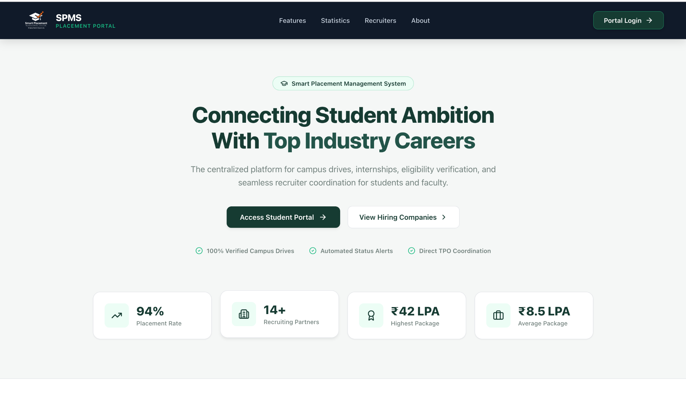
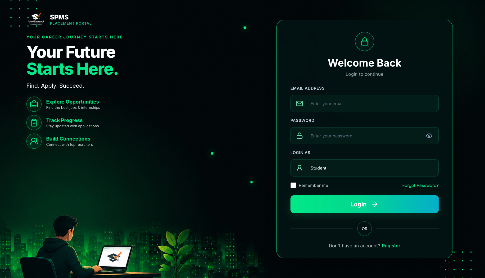
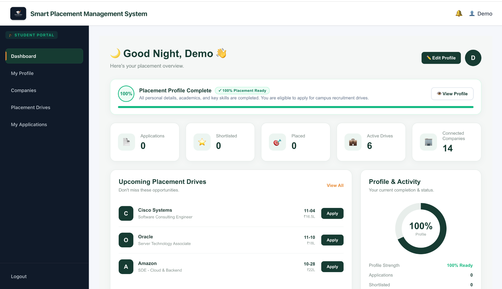
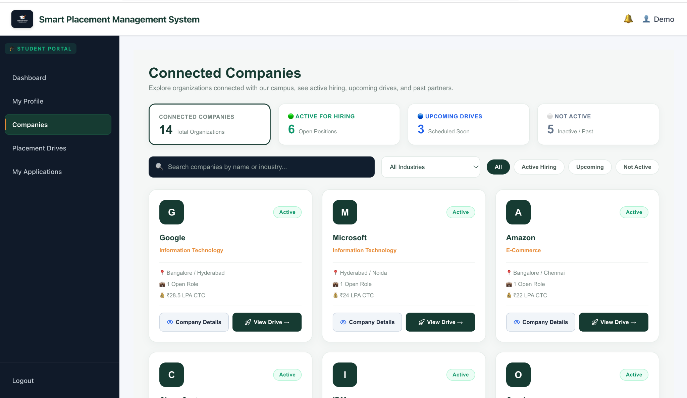
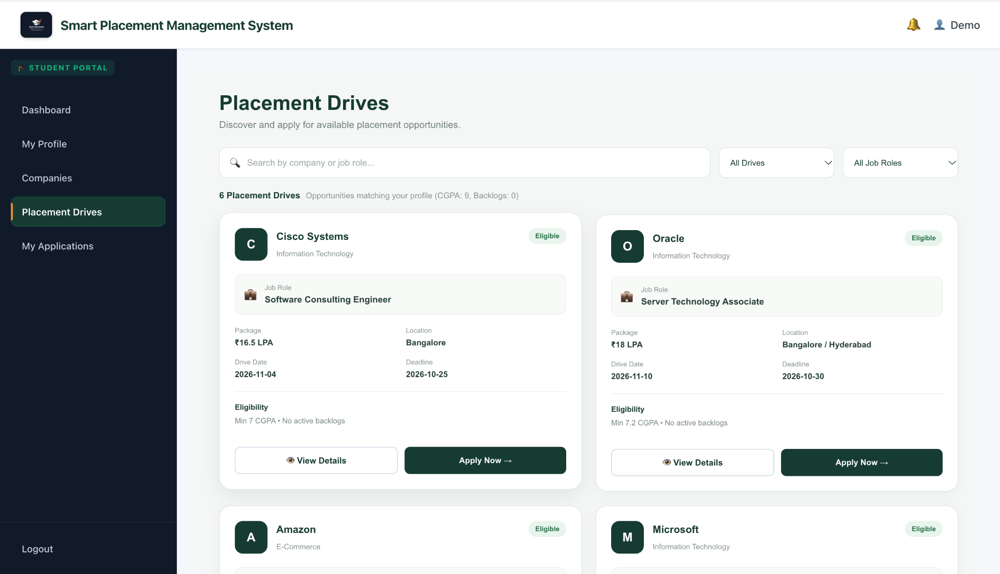

# 🎓 Smart Placement Management System (SPMS)

A web-based placement portal designed to simplify campus recruitment by helping students explore placement opportunities, manage profiles, and track job applications.

## 🚀 Overview

The Smart Placement Management System (SPMS) provides a centralized platform for student placement activities. It includes a user-friendly interface for exploring companies, viewing placement drives, and managing applications.

## ✨ Key Features

- **Student Dashboard:** View placement readiness, applications, and upcoming placement drives.
- **Student Profiles:** Manage personal, academic, and placement-related information.
- **Company Directory:** Browse recruiting companies and hiring statuses.
- **Placement Drives:** Explore job roles, eligibility criteria, locations, and packages.
- **Application Tracking:** Monitor placement application progress.
- **Authentication:** Login and registration interfaces.
- **Admin Tools:** Support placement administration and student management.

## 🛠️ Technology Stack

- **Frontend:** React.js, JavaScript, HTML5, CSS3
- **Backend:** Python, Flask
- **Database:** Configure according to the database used by the backend


## 📸 Application Screenshots

### Landing Page


### Login Page



### Student Dashboard


### Connected Companies


### Placement Drives



## ⚙️ Getting Started

### Prerequisites

- Node.js and npm
- Python 3 and pip
- The database configured for the backend

### Frontend Setup

Open a terminal inside the frontend project directory and run:

```bash
npm install
npm start
```

### Backend Setup

Open a terminal inside the backend project directory and run:

```bash
python3 -m venv venv
source venv/bin/activate
pip install -r requirements.txt
python run.py
```

Configure the required environment variables and database connection before starting the backend.

## 🔐 Security

- Never upload `.env` files, passwords, API keys, or database credentials.
- Do not commit private student records or personal information.
- Keep dependency folders and generated cache files out of the repository.

## 🔮 Future Enhancements

- Placement analytics and reporting
- Email notifications for recruitment updates
- Enhanced search and filtering
- Cloud deployment

## 👨‍💻 Author

**Sumer Raj**

- GitHub: [@Sumer01](https://github.com/Sumer01)
- LinkedIn: [Sumer Raj](https://linkedin.com/in/sumerraj01)

---

*An academic project focused on simplifying campus placement workflows through web technology.*
